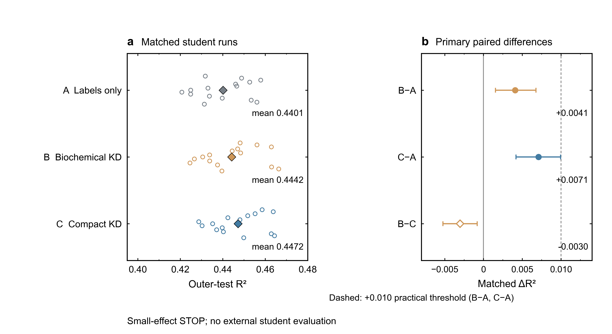

# Online Resource 1: Supplementary material

For: **Complementarity and transfer limits of sequence- and feature-based mRNA stability prediction in human and mouse**

Reference numbers refer to the main manuscript. Tables S1–S8 report the original evaluations; Tables S9–S12 report the post hoc saved-prediction analyses and source reassessment. Supplementary Methods S6 distinguishes these added analyses from the original evaluations. Supplementary Methods S7 and Tables S13–S14 describe the additional organoid measurement evaluation.

## Supplementary Methods S1. Archived human model settings

The human outer split used seed 42, five folds containing 2,600, 2,600, 2,600, 2,600 and 2,581 test genes, and target-quantile stratification with 20 bins. The configured internal-validation ratio was 0.1; the actual frozen validation counts, rather than an assumed exact fraction after stratification, define the partitions (Table S2).

The legacy sequence run used configured 5′UTR/CDS/3′UTR chunk lengths of 512/1,024/1,024 model tokens, including two special tokens, and configured stride parameters of 512/1,024/512. UTR content was nucleotide-tokenized; CDS content was codon-tokenized after trimming to a multiple of three. Consequently, content-token limits were 510/1,022/1,022 and effective content-token strides were 510/1,022/510. These values must not be described as 512/1,024/1,024 bases, particularly for CDS. At most 64 chunks were processed per forward pass. Low-rank adaptation (Hu et al. 2022; Kalajdzievski 2023) targeted query, key and value projections with rank 16, alpha 64 and zero adapter dropout; the training implementation enabled rank-stabilized scaling. Regional aggregation used a mean–max scheme with a 512-unit hidden layer and dropout 0.1. The prediction head used a 256-unit hidden layer and dropout 0.3223. Learning rate was 1.5935×10⁻⁵, weight decay 0.002159, warm-up fraction 0.05, maximum epochs 16 and early-stopping patience five epochs. The retained checkpoint maximized internal-validation R². Smooth-L1/Huber β was 1.2783. Although a correlation-loss weight field existed in the configuration, the selected `huber` branch did not activate the optional combined correlation loss. The selected configuration and corresponding implementation branch, rather than an inactive field, define the training objective. Microbatch size was eight, with accumulation over two batches, gradient clipping at one and training-only target standardization. The archived sequence model did not activate its optional CLIP integration.

Ridge evaluated 41 logarithmically spaced alpha values from 10⁻⁴ to 10⁴ using the LSQR solver, tolerance 10⁻⁴ and maximum 10,000 iterations. ElasticNet evaluated 33 logarithmically spaced alpha values from 10⁻⁵ to 10³ and L1 ratios 0.1, 0.5, 0.9 and 1.0. Both pipelines applied train-fitted imputation and scaling, clipped standardized features at ±5 and handled near-zero variance using the archived 10⁻⁶ threshold. Training-only target standardization used numerical safeguards of 10⁻⁶ for Ridge and 10⁻⁸ for ElasticNet. Validation R² selected regularization settings. These linear controls used the same outer test folds as XGBoost; the complete feature-group results appear in Table S1.

All reported clean XGBoost feature comparisons used the archived fixed configuration: `reg:squarederror`, histogram tree construction, 5,000 maximum estimators, learning rate 0.02, depth three, minimum child weight 10, subsample 0.8, column subsample 0.8, L2 penalty 10, L1 penalty 0.1 and validation-RMSE early-stopping patience 100. Common-Compact and Common-Full retained these settings; mouse outcomes did not determine the booster iteration or feature group. None of the model settings in this supplement were newly optimized for manuscript preparation.

The released biochemical input audit identified 34 continuous features with 81,660 historically imputed cells. Full-human PLS imputation excluded HALFLIFE but used unlabeled feature values from eventual test genes. This is retained and disclosed as transductive upstream preprocessing. BASIC plus the expanded 551-feature biochemical block gives 559 inputs; the historical 371-feature block is a different definition. Common-Compact contains 8 BASIC + 62 codon + 780 SeqWeaver averages + 177 DeepRiPe averages; Common-Full adds 21,844 3′UTR 1–7-mers. Human-only biochemical, unaudited CWCS/miRNA and alternative max/sum aggregations were excluded, as were mouse-only Codon.TAA and Codon.TAG. The 780/177 dimensions refer to the frozen Saluki-derived feature manifests, not to counts inferred from the model publications (Agarwal and Kelley 2022; Ghanbari and Ohler 2020; Zhou et al. 2019).

Feature-family abbreviations are RIP (RNA immunoprecipitation), ENCORI (Encyclopedia of RNA Interactomes), eCLIP (enhanced crosslinking and immunoprecipitation) and TE (translation efficiency). M6ACLIP and PARCLIP retain the released annotation-family names (Agarwal and Kelley 2022); definitions and individual feature identities follow the source feature manifest.

## Supplementary Methods S2. Attribution, ablation and negative controls

TreeSHAP explanations (Lundberg et al. 2020) were generated for the corresponding held-out fold of each Bio-XGB model. Absolute feature attributions were summarized both per feature and by feature family. Family totals and totals normalized by family dimensionality answer different questions and were kept separate. The 559 inputs were allocated to BASIC (8), RIP (33), ENCORI (133), eCLIP (225), M6ACLIP (13), PARCLIP (146) and TE (1). Correlation among annotations can redistribute attribution, and neither SHAP nor family aggregation provides a causal effect estimate.

Attributions came from a separately trained interpretation run with the same ordered features, outer test-gene assignments and scientific XGBoost settings as the benchmark. The stored test R² values for folds 0–4 were 0.680139, 0.677754, 0.667529, 0.673560 and 0.684099; these and the selected tree iterations agreed with the corresponding benchmark records. This agreement does not establish checkpoint byte identity. The runs used 16 and 12 computational threads, respectively. Feature rankings average the five saved fold-level mean absolute attributions. The saved gene-level table covers a union of 124 features, not a complete 559-feature matrix; all 20 displayed features have values for every one of the 12,981 held-out genes. Figure 1d uses these values directly, with display-only vertical packing and a constant orange color that does not encode feature magnitude. No SHAP values or model performance statistics were recomputed for this revision.

Feature-family ablation refitted the tabular model under the existing outer-fold and validation-selection framework after removing or retaining the specified blocks. Relative to full-panel mean R²=0.676616, the retrained values were 0.660568 without BASIC, 0.616673 without RIP, 0.653761 without ENCORI, 0.666410 without eCLIP and 0.559911 without both RIP and ENCORI. Single-family fits achieved 0.582180 with RIP, 0.486654 with ENCORI and 0.373252 with eCLIP. These are separate retrained models, not scores obtained by zeroing input columns of the primary model. Population and sample SDs in historical exports are not interchangeable; the main manuscript consistently uses population SD for the human five-fold benchmark.

Permutation negative controls used five permutation seeds across five outer folds for Ridge and XGBoost. Training and validation labels were independently permuted within their respective subsets; test labels remained true. Mean held-out R² values were −0.009529 for Ridge and −0.002952 for XGBoost. The control tests whether the pipeline retains target correspondence after that disruption; it does not resolve pretraining provenance, full-human feature preprocessing or dependence between related genes.

The five human Bio-Fusion−Bio-XGB ΔR² values ranged from 0.021701 to 0.028080 (mean 0.024143). Validation-fitted LM coefficients were positive in all folds (0.2494–0.3005). Signed residuals had fold-mean Pearson correlation 0.5683 and Spearman correlation 0.5444. TreeSHAP's prominent features included ORF exon density, RIP.YTHDF2.polyA.He, RIP.NUP98, RIP.CHD4 and RIP.WDR5. These frozen summaries are retained for interpretation, not used to select a new model or subgroup.

## Supplementary Methods S3. Matched distillation design and fixed decision rules

The formal distillation design used five outer folds and three seeds (42, 2026 and 3407). In every fold–seed triplet, A received label-only supervision, B received the biochemical-teacher soft target and C received the Common-Compact-teacher soft target. The 50 frozen teachers were generated by five inner folds for each of two teacher definitions within each of the five outer folds. Receiver exclusion applied to teacher fitting and teacher early stopping, and outer validation/test genes were not used in teacher construction. Teacher targets were not updated during student training.

All arms began from the original pretrained backbone with fresh, paired LoRA and head initialization. The students shared the sequence tokenization, chunking, rank-stabilized LoRA, mean–max aggregation and prediction-head architecture specified in S1. A shared precomputed 16-epoch sample-order schedule paired the training data order within each triplet. Training used AdamW with learning rate 1.5935×10⁻⁵, weight decay 0.002159, betas (0.9, 0.999), epsilon 10⁻⁸, warm-up fraction 0.05, gradient clipping at one, microbatch size eight and accumulation over two microbatches. Training used bfloat16 mixed precision and validation used float32. Maximum budget, patience and checkpoint criterion were shared; different observed stopping epochs were permitted by the same validation rule.

The maximum budget was 16 epochs with patience five; checkpoint improvement tolerance was 10⁻⁸. The frozen implementation preserved the historical cosine-schedule initialization, including its initial learning-rate multiplier, and the division by two in a final incomplete accumulation group. These behaviors were not silently changed between arms. Best-checkpoint selection used human internal-validation R², with an earlier checkpoint retained on ties. All three fixed seeds were retained in the matched analysis; no seed was selected for favorable performance.

Training-only mean and standard deviation scaled both labels and teacher predictions. The A loss was Huber alone; the B/C loss was 0.75×Huber(student,label)+0.25×Huber(student,teacher), with the same β=1.2783 and a detached soft target. Mouse and external-human labels were absent from this training pathway. Validation selected checkpoints but did not generate teacher targets.

All 45 final checkpoints were frozen before outer-test inference. Sequence-only inference was completed before evaluation joined the held-out labels. Outer-test outcomes did not determine teachers, feature definitions, split, λ, loss, architecture, training budget, seeds or checkpoints.

The primary matched estimand and paired bootstrap are defined in main Methods §2.9 and Supplementary Methods S5. Fold-population SD summarizes the five seed-averaged fold contrasts; seed-population SD summarizes the three fold-averaged seed contrasts. Neither is the gene-bootstrap CI. A practical GO required ΔR²≥0.010 plus the predefined consistency, positive-CI and safety conditions; ΔR²≥0.020 was the stronger-effect threshold. Biochemical-specific support additionally required B−C≥0.005 with a positive lower interval bound and a B−A GO result. Neither KD arm met the practical GO criterion, and biochemical-specific support was absent. The decision was a practically small distillation effect (STOP); these students were not evaluated externally. No secondary estimand replaced that decision.

The protocol and primary endpoint were locked after an acknowledged engineering pilot and earlier human benchmark development, not before all exploratory work. The pilot used inherited trained components and is not an additional unbiased formal run; its observations are excluded from the formal matched effect estimates.

### S3.1 Complete frozen effect and safety rules

For a candidate KD arm versus A, practical GO required all of the following: mean matched ΔR²≥0.010; positive seed-averaged differences in at least four of five folds; positive fold-averaged differences in at least two of three seeds; a strictly positive lower paired 95% CI bound; no systematic reversal in either Spearman or Pearson; and no numerical or calibration pathology. A strong B−A magnitude additionally required ΔR²≥0.020 and did not bypass the other conditions. The same GO conditions applied separately to C−A.

Systematic reversal meant a negative correlation difference in at least four seed-averaged folds **and** at least two fold-averaged seeds for either correlation. Numerical failure comprised nonfinite inputs, predictions or metrics, constant predictions, or prediction-SD/label-SD outside [10⁻⁶,10⁶] in any fold×seed×arm. Reporting-only OLS calibration diagnostics flagged nonpositive slopes in at least four seed-averaged folds **or** at least two fold-averaged seeds. Intercept, slope, SD ratio, mean error and RMSE were diagnostic outputs, never calibration adjustments.

Biochemical-specific support required B−A GO, B−C ΔR²≥0.005, and a strictly positive lower paired B−C CI bound. B−C magnitude was classified as strong at ≥0.010, modest at ≥0.005 and <0.010, too small for a strong privilege claim at >0 and <0.005, and unsupported at ≤0. A positive point with an interval crossing zero remained uncertain.

Terminal rules were applied in order:

1. B−A GO plus the B−C support condition: biochemical privileged distillation supported, with magnitude qualified.
2. B−A GO without the B−C condition: generic teacher distillation supported, not biochemical-specific.
3. C−A GO without B−A GO: common-teacher distillation supported.
4. Neither GO, both mean ΔR²<0.010, and at least one positive mean with positive paired CI: distillation effect practically small.
5. Otherwise: distillation not supported; this is not proof of exactly zero effect.

B−A ΔR²<0.010 required stopping for a small effect even with a positive CI. The observed formal outcome followed rule 4 and stopped without external evaluation.

The 50 teachers used the frozen XGBoost settings in S1, five inner folds, and seed 42+100×outer-fold+inner-fold. They were not refitted on all outer-training genes to generate receiver targets. No teacher target was updated during student training.

## Supplementary Methods S4. External-target and context-analysis implementation notes

RNAdecayCafe (Vock et al. 2025) was accessed through the version 1.1.0 Zenodo deposit (Vock 2025), with v1.1 data filenames. The overlap audit compared study, cell line, assay and accession information with the released Saluki source inventory. SRR6262128 and SRR6262129 were excluded before any matrix processing. Some historical raw source directories/accessions were unavailable, so the audit documents a bounded source-level assessment rather than exhaustive raw-experiment reconstruction.

The primary matrix retained 13,630 genes with at least 10 finite measurements from 62 samples. Columns were standardized with base::scale using sample SD. With seed 42, missMDA::estim_ncpPCA searched ncp.min=0 to ncp.max=20 using the default Regularized, scale=TRUE, generalized-cross-validation path and selected ncp=12. imputePCA used that component number and package defaults. Quantile normalization used preprocessCore::normalize.quantiles, followed by stats::prcomp(center=TRUE, scale.=FALSE). The sign was flipped only when median Pearson correlation with raw external −log(kdeg) columns was negative; no original benchmark target or model prediction was read for this choice (Bolstad 2025; Bolstad et al. 2003; Josse and Husson 2016).

The context-balanced matrix contained 16 dataset–cell-line means, retained 9,786 genes observed in at least 10 contexts, and selected four imputation components from an effective maximum of 15. Its final model-matched set contained 8,871 genes. The no-QN sensitivity retained 11,381 model-matched genes. Restricting Primary External-PC1 to the context-balanced evaluable genes gave Bio-Fusion−Bio-XGB ΔSpearman=0.008586; the balanced target gave 0.007932. Fourteen complete leave-one-dataset-out target refits had median Spearman concordance 0.998963 and minimum 0.996244 with the complete target. These summaries were transcribed, not recalculated.

The external consensus used R 4.5.3, missMDA 1.22 and preprocessCore 1.72.0, with preprocessCore threading disabled. The no-QN sensitivity independently repeated component selection and imputation rather than assuming that an imputed matrix selected for a different target pipeline was interchangeable. Dataset-deletion sensitivity likewise repeated the target construction within each retained source set. No model outcome guided target sign or preprocessing selection.

The 16 human context targets used available raw −log(kdeg) means within context; the 27 mouse targets used the official raw-measurement columns and their model-blind frozen orientation. Intervals are conditional on the matched genes and fixed predictions in each scope. Context and measurement counts summarize repeated assessments with shared genes and source backgrounds. They are not denominators for a binomial test of independent study successes.

The mouse robustness interpretation follows the qualitative plan and the full per-measurement estimates. Numerical classification cutoffs introduced during implementation were not part of the original qualitative plan and are not the basis of the interpretation here. The descriptive report classification is supported by the broad direction pattern, with retained negative and uncertain comparisons. Assay, cell type, study and coverage are confounded; their descriptive summaries do not identify a causal driver.

External-PC1 explained 79.25% of the processed measurement variance. Its correlation with the original human target was Spearman 0.919968 (95% CI, 0.916209–0.923504). Bio-Fusion−Bio-XGB ΔSpearman was 0.007932 for the context-balanced target and 0.014117 for the no-QN target. Across the 16 contexts, the median fusion difference was 0.008293; all point estimates were positive, while two K562 intervals included zero.

## Supplementary Methods S5. Complete statistical definitions and seed rules

The human primary benchmark reports the unweighted mean of five outer-fold metrics, with population SD (ddof=0) where stated. Bio-Fusion contrasts are fold-matched differences. Human pooled OOF metrics for the common-input analysis combine the held-out prediction for each gene and are identified separately. Fold means, pooled OOF statistics and ensemble-prediction statistics are not interchangeable.

External-human and mouse primary evaluations used Spearman correlation, with Pearson correlation secondary. For each pooled scope, 5,000 gene-level bootstrap resamples with seed 42 supplied percentile 95% intervals. The same resampled indices were applied to all compared models to obtain paired differences. External context evaluations used seed 42 plus the zero-based lexicographic context index. Mouse strata and individual measurements likewise preserved model pairing within their predefined scope; each mouse measurement used seed 42 plus its zero-based lexicographic experiment index. Fractions of bootstrap differences above zero were descriptive direction-stability summaries, not p values. No context-level t-test, Wilcoxon test, false-discovery-rate procedure or meta-analysis was used to turn shared measurement contexts into independent replicates.

For PD4, the primary estimand for B−A was

\[
\overline{\Delta R^2}_{B-A}
=\frac{1}{15}\sum_{k=0}^{4}\sum_{s\in\{42,2026,3407\}}
\left(R^2_{B,k,s}-R^2_{A,k,s}\right),
\]

with analogous B−C and C−A contrasts. Each of 5,000 global gene-bootstrap draws used one common index vector across all three seeds and three arms, recalculated each fold-by-seed R² and averaged the 15 paired differences. Fold identities were retained while bootstrap fold counts could vary. Seeds were not resampled; fold and seed variation were reported separately. Pooled per-seed OOF and seed-averaged prediction metrics were secondary. The gene bootstrap conditions on the trained models and does not capture all training variability or gene-family dependence.

The Common-Full sensitivity model reached mouse Spearman 0.613064, differing from Common-Compact XGB by −0.001080 (95% CI, −0.004373 to 0.002186). Common-Fusion's Pearson gain over LM was 0.021355 (0.015945–0.026537). Across the 27 measurements, matched sample sizes ranged from 376 to 12,939. Median Spearman correlations were 0.522282 for LM, 0.491069 for Common-Compact XGB and 0.534562 for Common-Fusion. Median fusion gains were 0.037955 over Common-Compact XGB and 0.019707 over LM.

## Supplementary Methods S6. Post hoc comparisons, coverage and source reassessment

### S6.1 Fixed-input comparisons and uncertainty

The supplementary analysis was undertaken after the original human, external-human and mouse results were known. Its scope and input hashes were recorded before calculating the added comparisons, but this was not prospective study preregistration. Models, features, splits, targets and fusion coefficients were unchanged.

Eight saved predictors were compared on the same 12,981 human ENSIDs: BASIC XGB, LM, Ridge, ElasticNet, Bio-XGB, Bio-Fusion, Common-Compact XGB and Common-Fusion. BASIC used the eight structural inputs; Ridge and ElasticNet used the 559-feature panel. Identifier and fold alignment were exact. Canonical human targets were retained, with historical target serialization differences checked within an absolute tolerance of 10⁻⁵. Shared external prediction exports agreed within 10⁻¹²; this tolerance accommodated floating-point serialization, not changes to saved predictions.

For the external comparison, saved Common predictions were joined to the frozen 11,381-gene intersection without recovering aliases or adding genes. LM, Bio-XGB and Bio-Fusion retained their original predictions. Spearman and Pearson were reported externally; human pooled OOF also included R². The eight contrast directions are listed in Tables S9b and S10b. All were retained regardless of sign or interval bounds. The extension did not evaluate Common models on the balanced, no-QN or 16 context targets.

Each population used 5,000 iid gene-bootstrap draws, NumPy default_rng seed 42, and shared indices across all models and metrics. Spearman used average-tie ranks recalculated within each resample, including repeated genes. The 95% percentile bounds used linear interpolation at 0.025 and 0.975. Human five-fold means and population SDs were tabulated separately (Table S9c); neither quantity was substituted for pooled OOF uncertainty. Intervals are exploratory and pointwise, without multiplicity adjustment. They condition on fixed predictions, target construction and preprocessing, omit model-training and target-estimation uncertainty, and do not address gene-family dependence.

### S6.2 Coverage diagnostics

Membership in the external intersection partitioned the original benchmark into 11,381 matched and 1,600 unmatched genes. Each group retained its original human labels, OOF predictions and fold identities. Internal R², Spearman and Pearson were summarized for LM, Bio-XGB, Bio-Fusion, Common-Compact XGB and Common-Fusion. These are descriptive within-group metrics, not external performance estimates for unmatched genes.

Available descriptors were UTR5LEN, CDSLEN, INTRONLEN, UTR3LEN, UTR5GC, CDSGC, UTR3GC and TOTAL_LEN_SEQ, alongside the original target and recorded external coverage. Their source values were not reconstructed or used for fitting. The full descriptive exports report counts, missingness, means, sample SDs, medians, quartiles and ranges. Standardized mean differences are matched minus unmatched means divided by the square root of the average group sample variances. These differences use observed values only, with no significance tests, covariate adjustment, gene filtering or reweighting.

Of the unmatched genes, 910 had an exact-symbol coverage record with fewer than ten finite measurements. The remaining 690 had no exact-symbol coverage match and were left missing, not assigned zero measurements. Thus, the coverage summaries for unmatched genes describe only those with a recorded match. The 1,600 genes excluded from the human benchmark intersection are distinct from the 2,249 external-target genes absent from that benchmark. Descriptor summaries use the existing processed feature table, not newly reconstructed raw assays or a fold-local preprocessing rerun.

### S6.3 Bounded accession reassessment

The reassessment covered 64 candidate samples from 15 datasets and the 19 human source studies in Saluki Table 1 (Agarwal and Kelley 2022). It combined source publications, repository records, original integration scripts and archived RNAdecayCafe processing configurations (Vock 2025; Vock et al. 2025). The two previously excluded Schofield K562 runs, SRR6262128 and SRR6262129, map to Simon-named columns in the Saluki integration script. Their exclusions remained unchanged.

All 59 other retained samples with original SRR identifiers appeared in the archived processing configurations. No additional overlap was identified within the documented source scope, but complete historical read-level inventories were unavailable. Different publication dates alone were not treated as evidence of independent experiments.

For the three Mabin DMSO aliases, later public GEO/SRA metadata supplied candidate mappings through GSE289489 and PRJNA1223303 (Table S12b). Study, treatment and replicate metadata supported these correspondences. Original read checksums and a depositor-confirmed alias crosswalk were unavailable, so the alias mappings remain provisional. The local HEK293T dataset name and HEK293/HEK-293 metadata labels were both retained without silently harmonizing them.

Two upstream citation links were corrected in the audit, while retaining their original identifiers (Table S12c). Finkel's GSE162323 records point to PMID 33979833 rather than the repository-linked PMID 35313595. Luo's GSE143662 records point to PMID 32365300 rather than PMID 33357462. These metadata corrections did not change sample inclusion, targets or measurements. Full URLs, source references, decisions and qualification fields accompany Table S12 as machine-readable records.

### S6.4 Numerical verification and reproducibility scope

The additional organoid evaluation and its independent statistical reproduction are described separately in S7; the scope below concerns the preceding analyses.

Statistical reproduction used saved gene-level targets and predictions with fixed evaluation definitions. The CPU-only workflow recalculates the supported human and primary external-human comparisons, primary mouse and ortholog-stratified analyses, all 27 mouse measurements and 16 human contexts. It also recalculates the primary and secondary matched-distillation analyses (PD4). Bootstrap intervals for these implemented estimands use the original 5,000-resample definitions, paired indices, gene order and seeds. Five-fold population standard deviations are reported separately as descriptive summaries, not confidence intervals. Recalculated estimates and intervals were checked against frozen references; their uncertainty remains conditional on the supplied predictions and targets.

The isolated Python environment used Python 3.12.3, NumPy 1.26.4, pandas 2.1.4 and SciPy 1.11.4. Tables 1–3, Figures 1–4 and S1, and three supplementary workbooks were regenerated from saved source data. Figure rendering used Matplotlib 3.9.2 and Pillow 10.4.0, with dependencies recorded in the supplied lockfile.

A separate, freshly installed Linux R environment reconstructed External-PC1 from the bundled processed matrices. It used R 4.5.3, missMDA 1.22, preprocessCore 1.72.0 and jsonlite 2.0.0, including the recorded non-threaded preprocessCore source build. Primary, context-balanced and no-quantile-normalization target values matched the frozen CSV values exactly. The primary target contained 13,630 genes; its direction, 11,381-gene matched intersection and specified model correlations were verified. All 14 leave-one-dataset-out targets were generated, with gene counts and summary statistics matching the frozen references. Original per-gene leave-one-dataset-out references were not bundled, so these targets were not compared value by value.

The R reconstruction starts from processed matrices and does not reanalyse original sequencing reads. Balanced and no-quantile-normalization model-performance intervals and Saluki–External-PC1 target-concordance intervals were not recomputed. Historical feature-group, ablation and permutation runs, fusion coefficient fitting, Common-Full sensitivity and SHAP computation were not rerun. Selected ortholog context and target-concordance diagnostics and curated provenance conclusions also remain stored evidence. Complete model training and weight-based inference were not rerun and are outside the self-contained reproduction scope.

## Supplementary Methods S7. Additional evaluation using patient-derived organoid SLAM-seq half-lives

### S7.1 Published measurements and the evaluation set

We evaluated the existing human predictors against control-condition SLAM-seq half-lives from the MSK107Li patient-derived colorectal cancer liver-metastasis organoid reported by Jiang et al. (2026; doi:10.1038/s41586-026-10890-0; GEO GSE336417). The non-targeting shRNA control (shCtrl) represents one organoid line under the published experimental conditions. Unlabelled samples were used for background correction in the original experiment, not as separate half-life targets. We used the GEO processed file GSE336417_SLAMseq_halflife.csv.gz, with control half-life in hours (hl_exp_ctrl) and the single-exponential decay-fit coefficient of determination (r2_exp_ctrl). No sequencing reads were reprocessed.

The GEO table and the article's Supplementary Table 5e contained the same 5,888 unique gene symbols. Their control values agreed within the published numerical precision and yielded identical quality-filter membership; GEO values were retained throughout. The original study identified these transcripts as peaking at 2 h and fitted decay using the 2-, 5- and 12-h measurements. The processed tables recover that published gene list, but do not provide the time-resolved data needed to repeat peak calling or decay fitting. Our evaluation used control measurements without selecting genes by knockdown half-lives, perturbation effects, binding assays or the enrichment set in the original Supplementary Table 5f.

We required a finite, positive control half-life and a finite R²_exp within [0, 1] and strictly greater than 0.6, leaving 5,369 genes. Gene symbols were matched case-sensitively and exactly to unique symbols in the frozen human out-of-fold (OOF) prediction table, from which Ensembl gene identifiers (ENSIDs) were obtained. Missing or ambiguous symbols were excluded; no alias rescue or prediction-based mapping was used. Of the quality-filtered genes, 479 lacked an exact match, leaving 4,890 genes with finite predictions from all five models. There were no additional prediction-missing exclusions. The primary set was ordered by ENSID. All 251 estimates above the final 12-h chase time were retained, without clipping or imputation; the retained range was 0.973843235–43.37544277 h. R²_exp > 0.6 denotes the adopted control decay-fit criterion, not high precision of individual half-life estimates.

### S7.2 Fixed predictions and paired evaluation

LM, Bio-XGB, Bio-Fusion, Common-XGB and Common-Fusion predictions were taken from the original gene-level human OOF table. Common-XGB denotes Common-Compact XGB. Original folds, predictions and fusion coefficients were retained, with no additional training, inference, calibration, fusion fitting or model selection using organoid labels. Spearman correlation used half-life in hours; secondary Pearson correlation used log2 half-life without a pseudocount. The sole primary comparison was Bio-Fusion minus Bio-XGB in Spearman correlation. Secondary contrasts were Bio-Fusion minus LM, Common-Fusion minus Common-XGB, Common-Fusion minus LM, and Bio-XGB minus LM. The latter contrast and the fold-direction diagnostic were added in a documented protocol amendment before any performance calculation; the original protocol and both frozen versions are retained in the repository.

We used 5,000 paired gene-bootstrap samples of the original sample size, drawn with replacement using NumPy default_rng(42). Models shared each draw's indices. Spearman ranks were recomputed within every draw, including repeated genes, using average ranks for ties. Two-sided 95% percentile intervals used the 2.5th and 97.5th percentiles with linear interpolation. Each contrast was calculated within the paired draw, not by subtracting marginal intervals. Undefined draws would stop interval reporting rather than be discarded or replaced; none occurred. Secondary intervals are descriptive and were not multiplicity-adjusted. Original folds 0–4 were used to report Bio-XGB and Bio-Fusion correlations and their differences without fold-specific intervals, reweighting or selection (Tables S13 and S14d).

### S7.3 Common-target and coverage analyses

The 4,801 primary genes also present in the frozen External-PC1 evaluation table formed a separate common-target set. The other 89 genes remained in the primary analysis. On this identical set, we compared all five predictions with the original Saluki target, External-PC1 and organoid half-lives, retaining the original directions and values of both existing targets. We also calculated pairwise target correlations and Bio-Fusion minus Bio-XGB gains under each target. Pearson target comparisons applied log2 only to organoid half-lives. A separate 5,000-draw bootstrap initialized with seed 42 used shared indices across all models and targets. Differences between target-specific gains were calculated within each draw and interpreted descriptively (Table S14a–c).

Coverage diagnostics considered all 12,981 human benchmark genes: 4,890 included, 425 with an exact published match but failing control quality filtering, and 7,666 without an exact match to the published list. The latter two groups comprised 8,091 non-included genes. We summarized original target distributions, sequence and regional lengths, regional GC content, and recorded External-PC1 measurement coverage, retaining missingness. These coverage counts describe the earlier external-human sources, not SLAM-seq read depth or expression, which were unavailable in the processed files. Original-target OOF correlations were summarized by group, including the 4,801 common-target genes and the remaining 89 primary genes; no organoid accuracy was assigned to non-included genes (Table S14e–g).

### S7.4 Provenance, uncertainty and reproduction

Comparison with the documented Saluki and RNAdecayCafe source inventories identified no overlapping study, sample or sequencing-experiment identifiers. This is an inventory-level check, not read-level deduplication. Evaluation concerns new measurements on benchmark-represented genes in one MSK107Li shCtrl background. Gene-bootstrap intervals condition on the fixed predictions, target estimates and observed genes; they do not incorporate model retraining, decay-fit uncertainty or between-patient variation. The five folds are prediction-partition diagnostics, not five biological replicates, and differences across targets do not isolate organoid biology from assay or processing effects.

The CPU reproduction module reconstructs both gene sets from the released processed data and frozen predictions, recalculates the stated statistics, and compares them with full-precision references. An independent implementation reconstructs the input joins and all 10,000 bootstrap draws using pandas ranking and correlation with explicit percentile interpolation, without importing the evaluation's statistical functions. Python, NumPy, pandas and SciPy versions are those specified in S6.4. The repository provides source receipts, versioned protocols, matching and quality-control records, per-gene tables and independent-check records. This module supplements the reproduction scope in S6.4; it does not extend that scope to raw-read processing or model retraining.

## Supplementary Note S1. Boundary of historical exploratory analyses

Historical analyses grouped transcripts by observed fusion gain and examined sequence composition and selected examples. Such outcome-defined analyses are exploratory and cannot identify a prospective rescue subgroup or establish a mechanism. They are not part of the primary evidence presented here; no historical motif/k-mer result or case-study panel is included. No new motif, attribution or subgroup analysis was performed for this revision.

## Table S1. Eight human feature groups and three learner families

Values are held-out R², unweighted five-fold mean ± population SD (ddof=0). The full-biochemical block contains 551 features; BASIC+full-biochemical is the 559-feature Bio-XGB input. The best high-dimensional ElasticNet result does not use that same 559-feature panel.

| Feature group | Features | Ridge | ElasticNet | XGBoost |
|---|---:|---:|---:|---:|
| BASIC | 8 | 0.333017 ± 0.015484 | 0.333030 ± 0.015486 | 0.383432 ± 0.010777 |
| GENETIC | 23,005 | 0.264325 ± 0.016540 | 0.322398 ± 0.020273 | 0.350998 ± 0.019386 |
| Biochemical, original | 371 | 0.534024 ± 0.008158 | 0.537313 ± 0.008480 | 0.569606 ± 0.007304 |
| GENETIC + original biochemical | 23,376 | 0.499966 ± 0.009763 | 0.582763 ± 0.011529 | 0.584540 ± 0.010555 |
| BASIC + GENETIC + original biochemical | 23,384 | 0.533657 ± 0.007692 | 0.617763 ± 0.009474 | 0.618015 ± 0.008586 |
| Full biochemical | 551 | 0.605106 ± 0.014894 | 0.609508 ± 0.014101 | 0.660568 ± 0.009054 |
| BASIC + full biochemical | 559 | 0.630643 ± 0.013185 | 0.633823 ± 0.013113 | 0.676616 ± 0.005685 |
| GENETIC + full biochemical | 23,556 | 0.566696 ± 0.016693 | 0.637399 ± 0.014145 | 0.652709 ± 0.010013 |

## Table S2. Locked human-validation fusion coefficients

Each row is an independently fitted human-fold equation: prediction=intercept+coefficient_XGB×XGB_prediction+coefficient_LM×LM_prediction. Coefficients are unconstrained OLS parameters, not percentages. Bio-Fusion uses Bio-XGB; Common-Fusion uses Common-Compact XGB. Only the latter was applied to mouse, averaging the five fold-specific fused predictions.

| Fusion | Human fold | Validation n | Intercept | XGB coefficient | LM coefficient |
|---|---:|---:|---:|---:|---:|
| Bio-Fusion | 0 | 1,023 | −0.060132181 | 0.849710793 | 0.291621305 |
| Bio-Fusion | 1 | 1,022 | −0.092212355 | 0.854566502 | 0.249438167 |
| Bio-Fusion | 2 | 1,022 | −0.100516337 | 0.846580494 | 0.267913628 |
| Bio-Fusion | 3 | 1,022 | 0.099691665 | 0.873079026 | 0.261515426 |
| Bio-Fusion | 4 | 1,040 | 0.020674924 | 0.820906300 | 0.300457764 |
| Common-Fusion | 0 | 1,023 | −0.110153830 | 0.604840034 | 0.523752048 |
| Common-Fusion | 1 | 1,022 | −0.141911068 | 0.686209644 | 0.405862045 |
| Common-Fusion | 2 | 1,022 | −0.129140478 | 0.725223373 | 0.348800055 |
| Common-Fusion | 3 | 1,022 | −0.000050078 | 0.655504444 | 0.465485172 |
| Common-Fusion | 4 | 1,040 | 0.053062623 | 0.679624174 | 0.432507756 |

## Table S3. External-human target sensitivities

| Target | Matched genes | LM Spearman | Bio-XGB Spearman | Bio-Fusion Spearman | Bio-Fusion−Bio-XGB ΔSpearman | 95% paired CI |
|---|---:|---:|---:|---:|---:|---|
| Primary External-PC1 | 11,381 | 0.662338 | 0.815017 | 0.829093 | 0.014076 | [0.011890, 0.016245] |
| Context-balanced External-PC1 | 8,871 | 0.657768 | 0.835431 | 0.843363 | 0.007932 | [0.005816, 0.010101] |
| No-QN External-PC1 | 11,381 | 0.662794 | 0.815158 | 0.829276 | 0.014117 | [0.011952, 0.016327] |

On the 8,871-gene balanced-target intersection, the primary target's Fusion−Bio-XGB point difference was 0.008586. This same-gene-set restriction is distinct from the full primary estimate and shows why the smaller context-balanced increment cannot be attributed solely to normalization or target construction. All model comparisons within a row use identical genes and 5,000 paired resamples. Target definitions and matching were frozen before model evaluation.

## Table S4. Ortholog strata and common-branch complementarity

### S4a. Mouse ortholog-stratified Spearman correlations

| Stratum | n | Model | Spearman | 95% CI |
|---|---:|---|---:|---|
| Represented current human 1:1 ortholog | 10,200 | LM | 0.677367 | [0.665792, 0.688745] |
| Represented current human 1:1 ortholog | 10,200 | Common-Compact XGB | 0.662507 | [0.650339, 0.673672] |
| Represented current human 1:1 ortholog | 10,200 | Common-Fusion | 0.710257 | [0.699508, 0.720539] |
| No current represented 1:1 ortholog | 3,544 | LM | 0.522481 | [0.495970, 0.548662] |
| No current represented 1:1 ortholog | 3,544 | Common-Compact XGB | 0.500157 | [0.472169, 0.526912] |
| No current represented 1:1 ortholog | 3,544 | Common-Fusion | 0.535610 | [0.508075, 0.561387] |

### S4b. Paired mouse Spearman differences

| Stratum | Contrast | ΔSpearman | 95% CI |
|---|---|---:|---|
| Represented | Common-Fusion−LM | 0.032891 | [0.026369, 0.039223] |
| Represented | Common-Fusion−Common-Compact XGB | 0.047751 | [0.043461, 0.052241] |
| No current represented 1:1 | Common-Fusion−LM | 0.013129 | [−0.000577, 0.026523] |
| No current represented 1:1 | Common-Fusion−Common-Compact XGB | 0.035453 | [0.027922, 0.043341] |
| Represented minus no-current gain | (Common-Fusion−LM) difference | 0.019761 | [0.004821, 0.034363] |

Intervals come from the final ortholog-stratified analysis, not earlier stage-specific resamples. The two strata were resampled independently for the between-stratum contrast while preserving within-stratum model pairing. Target concordance on represented human–mouse pairs was Spearman 0.766909 and Pearson 0.779315; it is a descriptive reference rather than a performance ceiling. Length, GC and target-distribution differences remain potential confounders of the strata comparison.

### S4c. Human versus mouse common-branch correlations

| Quantity | Human pooled OOF Spearman | Human Pearson | Mouse ensemble Spearman | Mouse Pearson |
|---|---:|---:|---:|---:|
| LM prediction versus Compact prediction | 0.743709 | 0.760393 | 0.765468 | 0.782256 |
| LM signed residual versus Compact signed residual | 0.756644 | 0.772754 | 0.688300 | 0.722970 |

These are descriptive diagnostics on different species, target scales and prediction aggregation schemes. They do not establish identical residual structure or a conserved causal mechanism and were calculated only after fusion lock.

## Table S5. Primary matched distillation results

### S5a. Unweighted means of the 15 fold-by-seed metrics per arm

| Arm | Teacher | Mean R² | Mean Spearman | Mean Pearson | Mean RMSE |
|---|---|---:|---:|---:|---:|
| A | None | 0.440128 | 0.655093 | 0.669486 | 3.608728 |
| B | Biochemical, 559 inputs | 0.444209 | 0.655080 | 0.668290 | 3.595532 |
| C | Common-Compact, 1,027 inputs | 0.447230 | 0.657492 | 0.670734 | 3.585803 |

### S5b. Matched mean R² differences and decision context

| Contrast | Mean ΔR² | 95% paired CI | Fold population SD | Seed population SD | Positive seed-averaged folds | Positive fold-averaged seeds |
|---|---:|---|---:|---:|---:|---:|
| B−A | 0.004081 | [0.001543, 0.006758] | 0.004832 | 0.001459 | 3/5 | 3/3 |
| C−A | 0.007102 | [0.004189, 0.009953] | 0.005100 | 0.001533 | 4/5 | 3/3 |
| B−C | −0.003022 | [−0.005240, −0.000813] | 0.002253 | 0.000998 | 0/5 | 0/3 |

The confidence intervals resample genes with pairing across arms and seeds; they do not resample seeds or treat 15 fold–seed metrics as independent datasets. B−A Spearman difference was −0.000014 [−0.001738, 0.001715], C−A was 0.002399 [0.000356, 0.004358], and B−C was −0.002412 [−0.004115, −0.000720]. Both teacher-versus-A mean R² improvements were below the ≥0.010 practical threshold. C had the larger effect, so the result supplies no biochemical-teacher-specific advantage.

## Table S6. Distillation run-level and secondary R² summaries

The tables below transcribe saved metrics. The primary estimand is the equally weighted mean of matched fold-by-seed differences, not any pooled row or seed-averaged prediction result. Complete R², Spearman, Pearson and RMSE exports are retained in the frozen source-data records.

### S6a. All 45 formal runs, grouped as the 15 matched triplets

| Fold | Seed | Test n | A R² | B R² | C R² |
|---|---|---|---|---|---|
| 0 | 42 | 2,600 | 0.431800 | 0.448193 | 0.458547 |
| 0 | 2026 | 2,600 | 0.448876 | 0.456126 | 0.463775 |
| 0 | 3407 | 2,600 | 0.457881 | 0.462900 | 0.455234 |
| 1 | 42 | 2,600 | 0.452697 | 0.447021 | 0.451773 |
| 1 | 2026 | 2,600 | 0.446064 | 0.444444 | 0.442421 |
| 1 | 3407 | 2,600 | 0.446599 | 0.448412 | 0.448103 |
| 2 | 42 | 2,600 | 0.433045 | 0.433830 | 0.428724 |
| 2 | 2026 | 2,600 | 0.424928 | 0.430574 | 0.435252 |
| 2 | 3407 | 2,600 | 0.420763 | 0.426658 | 0.430292 |
| 3 | 42 | 2,600 | 0.424911 | 0.433863 | 0.439775 |
| 3 | 2026 | 2,600 | 0.433738 | 0.424588 | 0.437131 |
| 3 | 3407 | 2,600 | 0.439776 | 0.437559 | 0.440315 |
| 4 | 42 | 2,581 | 0.453401 | 0.462983 | 0.462856 |
| 4 | 2026 | 2,581 | 0.456088 | 0.466361 | 0.464366 |
| 4 | 3407 | 2,581 | 0.431353 | 0.439616 | 0.449891 |

### S6b. Secondary pooled OOF and seed-averaged prediction R²

| Scope | Arm | R² | 95% CI |
|---|---|---|---|
| Seed 42 | A | 0.439204 | [0.424532, 0.453800] |
| Seed 42 | B | 0.445165 | [0.431124, 0.458664] |
| Seed 42 | C | 0.448299 | [0.434304, 0.461846] |
| Seed 2026 | A | 0.441914 | [0.426758, 0.456495] |
| Seed 2026 | B | 0.444381 | [0.430191, 0.458171] |
| Seed 2026 | C | 0.448535 | [0.434344, 0.462132] |
| Seed 3407 | A | 0.439231 | [0.424164, 0.453514] |
| Seed 3407 | B | 0.442983 | [0.428989, 0.456686] |
| Seed 3407 | C | 0.444738 | [0.430738, 0.458183] |
| Three-seed prediction mean | A | 0.457288 | [0.442894, 0.471047] |
| Three-seed prediction mean | B | 0.458959 | [0.445344, 0.472012] |
| Three-seed prediction mean | C | 0.460120 | [0.446602, 0.473299] |

### S6c. Secondary paired differences

| Scope | Contrast | ΔR² | 95% CI |
|---|---|---|---|
| Seed 42 | B−A | 0.005961 | [0.002073, 0.009939] |
| Seed 42 | B−C | −0.003135 | [−0.006705, 0.000411] |
| Seed 42 | C−A | 0.009095 | [0.004392, 0.013567] |
| Seed 2026 | B−A | 0.002467 | [−0.000846, 0.005911] |
| Seed 2026 | B−C | −0.004154 | [−0.007249, −0.000985] |
| Seed 2026 | C−A | 0.006621 | [0.003567, 0.009670] |
| Seed 3407 | B−A | 0.003751 | [0.000360, 0.007290] |
| Seed 3407 | B−C | −0.001755 | [−0.004783, 0.001339] |
| Seed 3407 | C−A | 0.005507 | [0.001359, 0.009631] |
| Three-seed prediction mean | B−A | 0.001670 | [−0.000848, 0.004277] |
| Three-seed prediction mean | B−C | −0.001161 | [−0.003322, 0.001057] |
| Three-seed prediction mean | C−A | 0.002831 | [−0.000107, 0.005610] |

In particular, the three-seed prediction-mean B−A interval includes zero. These secondary pooled results do not replace the fixed primary matched analysis or its STOP decision.

## Table S7. All 27 mouse measurements: model Spearman correlations and paired fusion differences

| Measurement | n | LM ρ | Common-Compact XGB ρ | Common-Fusion ρ | Common-Fusion−LM ΔSpearman [95% CI] | Common-Fusion−Common-Compact XGB ΔSpearman [95% CI] |
|---|---|---|---|---|---|---|
| Ameres_4sU_mESC_1 | 5,577 | 0.638757 | 0.626509 | 0.667164 | 0.028408 [0.019804, 0.036785] | 0.040655 [0.034703, 0.046851] |
| Bartel2_5EU_3T3_1 | 1,702 | 0.732122 | 0.720257 | 0.768369 | 0.036246 [0.021722, 0.050643] | 0.048112 [0.038130, 0.058535] |
| Bartel2_5EU_3T3_2 | 2,973 | 0.704919 | 0.718271 | 0.755837 | 0.050918 [0.039226, 0.062526] | 0.037566 [0.029642, 0.045708] |
| Bartel_ActD_3T3_1 | 10,268 | 0.598819 | 0.587103 | 0.627484 | 0.028665 [0.022112, 0.035526] | 0.040381 [0.035753, 0.044989] |
| Darnell_ActD_mESC_1 | 7,122 | 0.635202 | 0.658755 | 0.690746 | 0.055544 [0.047159, 0.064184] | 0.031991 [0.026729, 0.037638] |
| Dolken_4sU_M2-10B4_1 | 10,246 | 0.678784 | 0.664451 | 0.710009 | 0.031226 [0.024984, 0.037591] | 0.045558 [0.041119, 0.050062] |
| Hanna_ActD_EB_1 | 10,220 | 0.150084 | 0.135573 | 0.150368 | 0.000284 [−0.007914, 0.008968] | 0.014795 [0.009462, 0.020000] |
| Hanna_ActD_mESC_1 | 10,220 | 0.338919 | 0.339001 | 0.358626 | 0.019707 [0.011687, 0.027494] | 0.019624 [0.014623, 0.024684] |
| Hu_ActD_mESC_1 | 12,939 | 0.644648 | 0.669009 | 0.700698 | 0.056050 [0.050019, 0.062038] | 0.031689 [0.027971, 0.035542] |
| Ko_ActD_mESC_MC1.LIFneg | 10,692 | 0.516302 | 0.496606 | 0.534562 | 0.018260 [0.010750, 0.025874] | 0.037956 [0.033271, 0.042761] |
| Ko_ActD_mESC_MC1.LIFpos | 10,719 | 0.459055 | 0.478644 | 0.498878 | 0.039823 [0.032349, 0.047533] | 0.020234 [0.015500, 0.024981] |
| Ko_ActD_mESC_MC1.RApos | 10,566 | 0.535198 | 0.522249 | 0.560204 | 0.025006 [0.017559, 0.032409] | 0.037955 [0.033367, 0.042636] |
| Ko_ActD_mESC_MC2.LIFpos | 10,578 | 0.478236 | 0.491069 | 0.516000 | 0.037764 [0.030183, 0.045225] | 0.024932 [0.020355, 0.029661] |
| Koszinowski_4sU_3T3_1 | 376 | 0.568108 | 0.487622 | 0.559706 | −0.008401 [−0.045193, 0.029092] | 0.072085 [0.042807, 0.102853] |
| Mattick_ActD_Neuro2a_1 | 7,359 | 0.577739 | 0.611636 | 0.638818 | 0.061078 [0.052349, 0.069953] | 0.027181 [0.021267, 0.032895] |
| Regev2_4sU_Dendritic_1 | 6,927 | 0.138543 | 0.157817 | 0.160834 | 0.022292 [0.012433, 0.031779] | 0.003017 [−0.003780, 0.009722] |
| Regev_4sU_Dendritic_1 | 7,102 | 0.605650 | 0.602028 | 0.638208 | 0.032558 [0.024353, 0.040869] | 0.036181 [0.030501, 0.042046] |
| Rissland2_4sU_3T3_1 | 9,636 | 0.547806 | 0.524624 | 0.566032 | 0.018225 [0.011048, 0.025569] | 0.041408 [0.036438, 0.046254] |
| Rissland2_4sU_3T3_2 | 9,890 | 0.423558 | 0.405765 | 0.438321 | 0.014763 [0.006842, 0.022662] | 0.032556 [0.027554, 0.037774] |
| Selbach_4sU_3T3_1 | 4,480 | 0.512759 | 0.462337 | 0.518922 | 0.006163 [−0.005108, 0.017759] | 0.056585 [0.048020, 0.065030] |
| Selbach_4sU_3T3_2 | 4,480 | 0.445005 | 0.392426 | 0.445236 | 0.000231 [−0.011771, 0.011387] | 0.052810 [0.044117, 0.061538] |
| Simon_4sU_MEF_1 | 2,793 | 0.522282 | 0.455817 | 0.508613 | −0.013670 [−0.026598, −0.000869] | 0.052795 [0.043541, 0.062033] |
| Simon_4sU_MEF_2 | 2,793 | 0.511955 | 0.448112 | 0.498415 | −0.013540 [−0.026096, −0.000587] | 0.050303 [0.040944, 0.059437] |
| Wilusz_ActD_C2C12_1 | 5,240 | 0.351371 | 0.316894 | 0.352951 | 0.001580 [−0.010672, 0.013722] | 0.036058 [0.028478, 0.043932] |
| Wilusz_ActD_C2C12_2 | 5,240 | 0.322191 | 0.298145 | 0.328734 | 0.006543 [−0.006088, 0.018969] | 0.030589 [0.022666, 0.038476] |
| Wilusz_ActD_C2C12_3 | 5,240 | 0.428116 | 0.395826 | 0.437159 | 0.009043 [−0.003144, 0.021074] | 0.041332 [0.033466, 0.049157] |
| Zimmer_ActD_3T3_1 | 5,448 | 0.588798 | 0.558463 | 0.601288 | 0.012490 [0.003797, 0.021300] | 0.042826 [0.036195, 0.049377] |

Each row uses the same genes for all three frozen models. Intervals use 5,000 paired gene resamples with seed 42 plus the zero-based lexicographic measurement index. Negative Simon MEF contrasts and the uncertain Koszinowski Fusion−LM contrast are retained. Measurement identifiers preserve the official source nomenclature. Pearson metrics, individual-model intervals and direction summaries remain available in the complete frozen CSV exports.

## Table S8. All 16 external-human measurement contexts

| Dataset–cell-line context | n | LM ρ | Bio-XGB ρ | Bio-Fusion ρ | Bio-XGB−LM ΔSpearman [95% CI] | Bio-Fusion−Bio-XGB ΔSpearman [95% CI] |
|---|---|---|---|---|---|---|
| Finkel_etal_2021_Calu3__Calu3 | 9,995 | 0.651436 | 0.798837 | 0.811815 | 0.147402 [0.135902, 0.159308] | 0.012978 [0.010755, 0.015263] |
| Harada_etal_2022_MV411__MV411 | 9,660 | 0.595290 | 0.750930 | 0.759246 | 0.155640 [0.143229, 0.168318] | 0.008316 [0.005910, 0.010785] |
| Ietswaart_etal_2024_K562__K562 | 7,854 | 0.587797 | 0.780066 | 0.780977 | 0.192269 [0.178772, 0.205869] | 0.000910 [−0.001686, 0.003378] |
| Luo_etal_2020_HEK293T__HEK293 | 9,949 | 0.598712 | 0.766103 | 0.771940 | 0.167391 [0.155384, 0.179247] | 0.005837 [0.003466, 0.008230] |
| Mabin_etal_2025_HEK293T__HEK293 | 11,045 | 0.655184 | 0.802667 | 0.816034 | 0.147483 [0.136451, 0.158601] | 0.013368 [0.011147, 0.015579] |
| Mowery_etal_2018_Nalm6__Nalm6 | 7,610 | 0.556068 | 0.718285 | 0.725066 | 0.162217 [0.147618, 0.177199] | 0.006782 [0.003856, 0.009617] |
| Muhar_etal_2018_many__K562 | 9,015 | 0.551786 | 0.722762 | 0.725049 | 0.170976 [0.157812, 0.184101] | 0.002287 [−0.000245, 0.004887] |
| Muhar_etal_2018_many__MOLM | 9,053 | 0.566049 | 0.705639 | 0.715168 | 0.139589 [0.126703, 0.152293] | 0.009529 [0.006878, 0.012140] |
| Muhar_etal_2018_many__MV411 | 9,264 | 0.580046 | 0.729147 | 0.737417 | 0.149101 [0.135969, 0.162087] | 0.008270 [0.005644, 0.010777] |
| Narain_etal_2021_U2OS__U2OS | 8,615 | 0.590948 | 0.745285 | 0.753891 | 0.154337 [0.141039, 0.167649] | 0.008606 [0.005965, 0.011170] |
| Sheppard_etal_2021_CH22__CH22 | 8,451 | 0.602950 | 0.746198 | 0.761192 | 0.143248 [0.129761, 0.157225] | 0.014994 [0.012215, 0.017677] |
| Swartzel_etal_2022_MOLM14__MOLM | 8,507 | 0.612848 | 0.783460 | 0.788910 | 0.170612 [0.157706, 0.184048] | 0.005450 [0.003043, 0.007813] |
| Thiecke_etal_2020_HeLa__HeLa | 8,830 | 0.555381 | 0.713512 | 0.718590 | 0.158130 [0.144675, 0.171535] | 0.005079 [0.002413, 0.007749] |
| Williams_etal_2025_MDAMB__MDAMB | 9,946 | 0.537161 | 0.681057 | 0.687847 | 0.143896 [0.130950, 0.156783] | 0.006790 [0.004208, 0.009468] |
| Zhou_etal_2024_HEK293T__HEK293 | 10,260 | 0.632505 | 0.779844 | 0.792243 | 0.147339 [0.136028, 0.158677] | 0.012399 [0.010041, 0.014652] |
| Zuckerman_etal_2020_MCF7__MCF7 | 9,558 | 0.664564 | 0.794134 | 0.812281 | 0.129570 [0.118099, 0.141394] | 0.018147 [0.015894, 0.020457] |

The raw −log(kdeg) context means use no PCA, imputation or quantile normalization. Intervals use 5,000 paired gene resamples with context-specific seeds. All 16 fusion point differences are positive, but two K562 intervals include zero. Shared genes, models and experimental backgrounds prevent treating these 16 contexts as independent biological replications.

## Table S9. Unified human evaluation

### S9a. Human pooled OOF metrics

| Predictor | n | R² [95% CI] | Spearman ρ [95% CI] | Pearson r [95% CI] |
| --- | --- | --- | --- | --- |
| BASIC XGB | 12,981 | 0.383386 [0.369083, 0.397353] | 0.610771 [0.598682, 0.622587] | 0.619183 [0.607716, 0.630488] |
| LM | 12,981 | 0.443583 [0.428960, 0.457757] | 0.655637 [0.644667, 0.666068] | 0.668882 [0.658874, 0.678713] |
| Ridge | 12,981 | 0.630626 [0.618686, 0.641681] | 0.789306 [0.781473, 0.796747] | 0.794341 [0.786966, 0.801145] |
| ElasticNet | 12,981 | 0.633800 [0.622062, 0.644587] | 0.791603 [0.783868, 0.798925] | 0.796152 [0.788914, 0.802911] |
| Bio-XGB | 12,981 | 0.676602 [0.666309, 0.686361] | 0.812306 [0.805096, 0.819214] | 0.822567 [0.816307, 0.828562] |
| Bio-Fusion | 12,981 | 0.700730 [0.691046, 0.709892] | 0.827674 [0.820944, 0.834123] | 0.837120 [0.831420, 0.842609] |
| Common-Compact XGB | 12,981 | 0.490525 [0.477246, 0.503572] | 0.693625 [0.683185, 0.703826] | 0.700441 [0.690901, 0.709937] |
| Common-Fusion | 12,981 | 0.534396 [0.521304, 0.547042] | 0.725215 [0.715680, 0.734460] | 0.731079 [0.722211, 0.739737] |

All eight models use the same 12,981 genes and canonical human target. These post hoc fixed-prediction intervals do not replace five-fold means.

### S9b. Paired human pooled OOF differences

| Contrast | ΔR² [95% CI] | ΔSpearman [95% CI] | ΔPearson [95% CI] |
| --- | --- | --- | --- |
| Bio-XGB − LM | 0.233019 [0.219106, 0.247128] | 0.156670 [0.146676, 0.166964] | 0.153686 [0.144395, 0.163417] |
| Bio-Fusion − LM | 0.257147 [0.245567, 0.269179] | 0.172037 [0.163540, 0.180933] | 0.168238 [0.160246, 0.176451] |
| Bio-Fusion − Bio-XGB | 0.024128 [0.021059, 0.027246] | 0.015368 [0.013244, 0.017511] | 0.014553 [0.012690, 0.016461] |
| Common-Compact XGB − LM | 0.046942 [0.034287, 0.060117] | 0.037988 [0.028463, 0.047791] | 0.031559 [0.022626, 0.040700] |
| Common-Fusion − LM | 0.090812 [0.082821, 0.099407] | 0.069578 [0.063314, 0.076146] | 0.062197 [0.056667, 0.068129] |
| Common-Fusion − Common-Compact XGB | 0.043870 [0.038567, 0.049057] | 0.031590 [0.027613, 0.035711] | 0.030638 [0.026889, 0.034373] |
| Bio-XGB − Common-Compact XGB | 0.186077 [0.174727, 0.197448] | 0.118681 [0.110174, 0.126921] | 0.122126 [0.114092, 0.130122] |
| Bio-Fusion − Common-Fusion | 0.166334 [0.156852, 0.175656] | 0.102459 [0.095785, 0.109040] | 0.106041 [0.099571, 0.112426] |

Contrasts are first minus second. All eight specified contrasts are reported; intervals are pointwise, not multiplicity-adjusted.

### S9c. Human five-fold summaries, separate from pooled estimates

| Predictor | Folds | R², mean ± SD | Spearman, mean ± SD | Pearson, mean ± SD |
| --- | --- | --- | --- | --- |
| BASIC XGB | 5 | 0.383432 ± 0.010777 | 0.611064 ± 0.009913 | 0.619353 ± 0.008586 |
| LM | 5 | 0.443630 ± 0.011222 | 0.657620 ± 0.009342 | 0.670679 ± 0.009982 |
| Ridge | 5 | 0.630643 ± 0.013185 | 0.789516 ± 0.008703 | 0.794580 ± 0.008014 |
| ElasticNet | 5 | 0.633823 ± 0.013113 | 0.791908 ± 0.008532 | 0.796476 ± 0.007975 |
| Bio-XGB | 5 | 0.676616 ± 0.005685 | 0.812429 ± 0.006417 | 0.822599 ± 0.003473 |
| Bio-Fusion | 5 | 0.700759 ± 0.007963 | 0.828003 ± 0.005945 | 0.837245 ± 0.004699 |
| Common-Compact XGB | 5 | 0.490524 ± 0.008584 | 0.693853 ± 0.011192 | 0.700598 ± 0.006187 |
| Common-Fusion | 5 | 0.534421 ± 0.009824 | 0.725440 ± 0.009035 | 0.731419 ± 0.006770 |

Unweighted means and population SD (ddof=0); these are not confidence intervals. All 120 fold/model/metric rows are supplied in the full-precision source CSV.

## Table S10. Common and Bio predictions against External-PC1

### S10a. Five-model External-PC1 evaluation

| Predictor | n | Spearman ρ [95% CI] | Pearson r [95% CI] |
| --- | --- | --- | --- |
| LM | 11,381 | 0.662338 [0.650529, 0.673396] | 0.680827 [0.670253, 0.690728] |
| Bio-XGB | 11,381 | 0.815017 [0.807841, 0.822066] | 0.822382 [0.816143, 0.828365] |
| Bio-Fusion | 11,381 | 0.829093 [0.822306, 0.835544] | 0.837423 [0.831628, 0.842923] |
| Common-Compact XGB | 11,381 | 0.698821 [0.687996, 0.709275] | 0.717726 [0.707850, 0.727062] |
| Common-Fusion | 11,381 | 0.730096 [0.720157, 0.739225] | 0.746483 [0.737655, 0.754543] |

Saved human OOF predictions on the fixed 11,381-gene intersection. No external-label calibration or refitting. R² is not reported across distinct target/output scales.

### S10b. Paired external-human differences

| Contrast | ΔSpearman [95% CI] | ΔPearson [95% CI] |
| --- | --- | --- |
| Bio-XGB − LM | 0.152679 [0.141928, 0.163700] | 0.141555 [0.131934, 0.151348] |
| Bio-Fusion − LM | 0.166755 [0.157441, 0.176088] | 0.156596 [0.148379, 0.165135] |
| Bio-Fusion − Bio-XGB | 0.014076 [0.011890, 0.016245] | 0.015041 [0.013178, 0.016909] |
| Common-Compact XGB − LM | 0.036484 [0.025935, 0.046923] | 0.036898 [0.027362, 0.046195] |
| Common-Fusion − LM | 0.067758 [0.060860, 0.074613] | 0.065655 [0.059653, 0.071719] |
| Common-Fusion − Common-Compact XGB | 0.031274 [0.026988, 0.035686] | 0.028757 [0.024959, 0.032655] |
| Bio-XGB − Common-Compact XGB | 0.116195 [0.107533, 0.125003] | 0.104657 [0.096968, 0.112930] |
| Bio-Fusion − Common-Fusion | 0.098997 [0.092333, 0.105951] | 0.090940 [0.084953, 0.097202] |

All five models share resampled gene indices; 5,000 draws, seed 42. These are post hoc exploratory contrasts, with no multiplicity adjustment.

## Table S11. External-match coverage diagnostics

### S11a. Coverage groups within the human benchmark

| Group | Recorded coverage status | n |
| --- | --- | --- |
| matched | at_least_10_measurements | 11,381 |
| unmatched | below_10_measurements | 910 |
| unmatched | no_exact_symbol_match | 690 |

The unmatched group totals 1,600 genes. No exact symbol match means unknown coverage, not zero. Group labels are retained in machine-readable form.

### S11b. Internal OOF performance by external-match status

| Group | Predictor | n | R² | Spearman ρ | Pearson r |
| --- | --- | --- | --- | --- | --- |
| matched | LM | 11,381 | 0.477606 | 0.680145 | 0.691788 |
| matched | Bio-XGB | 11,381 | 0.712516 | 0.837691 | 0.844177 |
| matched | Bio-Fusion | 11,381 | 0.736031 | 0.852372 | 0.857939 |
| matched | Common-Compact XGB | 11,381 | 0.526753 | 0.720443 | 0.727754 |
| matched | Common-Fusion | 11,381 | 0.572344 | 0.752181 | 0.757704 |
| unmatched | LM | 1,600 | 0.078655 | 0.456296 | 0.465380 |
| unmatched | Bio-XGB | 1,600 | 0.299232 | 0.541398 | 0.554759 |
| unmatched | Bio-Fusion | 1,600 | 0.330356 | 0.568839 | 0.585839 |
| unmatched | Common-Compact XGB | 1,600 | 0.104416 | 0.483772 | 0.487570 |
| unmatched | Common-Fusion | 1,600 | 0.131967 | 0.509440 | 0.511372 |

Descriptive point estimates against the original human target. These are not external scores for unmatched genes; no group-difference CI or causal effect is claimed.

### S11c. Target, feature and coverage distributions

| Variable | Matched observed n | Unmatched observed n | Matched median [Q1, Q3] | Unmatched median [Q1, Q3] | Standardized mean difference |
| --- | --- | --- | --- | --- | --- |
| target | 11,381 | 1,600 | 0.228 [−3.163, 3.468] | −0.384 [−3.118, 1.781] | 0.167 |
| UTR5LEN | 11,381 | 1,600 | 190.000 [98.000, 328.000] | 170.500 [79.000, 326.250] | 0.028 |
| CDSLEN | 11,381 | 1,600 | 1433.000 [908.000, 2254.000] | 1270.500 [846.500, 1968.000] | 0.109 |
| INTRONLEN | 11,381 | 1,600 | 25510.000 [8846.000, 64418.000] | 13696.000 [4384.500, 44521.750] | 0.023 |
| UTR3LEN | 11,381 | 1,600 | 1089.000 [419.000, 2391.000] | 650.500 [270.000, 1534.250] | 0.315 |
| UTR5GC | 11,381 | 1,600 | 0.667 [0.588, 0.740] | 0.631 [0.547, 0.710] | 0.282 |
| CDSGC | 11,381 | 1,600 | 0.523 [0.451, 0.597] | 0.584 [0.500, 0.631] | −0.455 |
| UTR3GC | 11,381 | 1,600 | 0.423 [0.354, 0.520] | 0.482 [0.381, 0.562] | −0.323 |
| TOTAL_LEN_SEQ | 11,381 | 1,600 | 3222.000 [2046.000, 4912.000] | 2472.000 [1670.000, 3920.750] | 0.299 |
| n_measurements | 11,381 | 910 | 55.000 [36.000, 61.000] | 5.000 [3.000, 7.000] | 3.610 |
| n_datasets | 11,381 | 910 | 13.000 [9.000, 14.000] | 2.000 [1.000, 3.000] | 3.862 |
| n_cell_lines | 11,381 | 910 | 10.000 [7.000, 11.000] | 1.000 [1.000, 2.000] | 3.721 |

Length variables are in nucleotides, GC variables are fractions, target is the processed consensus score, and coverage variables are counts. Standardized mean differences use means, not the displayed medians. Missingness, means, sample SDs and full ranges are in the source CSV. Coverage summaries exclude 690 unknown unmatched records.

## Table S12. External-human source provenance

### S12a. Dataset-level accession and overlap summary

| Frozen dataset label | Candidate / retained n | GEO series | BioProject | Evidence status | Source PMID |
| --- | --- | --- | --- | --- | --- |
| Finkel etal 2021 Calu3 | 5 / 5 | GSE162323 | PRJNA681523 | B: bounded no-additional-overlap | 33979833 |
| Harada etal 2022 MV411 | 4 / 4 | Not recorded | PRJNA751732 | B: bounded no-additional-overlap | 35301220 |
| Ietswaart etal 2024 K562 | 4 / 4 | GSE207924; GSE207926 | PRJNA857695 | B: bounded no-additional-overlap | 38964322 |
| Luo etal 2020 HEK293T | 4 / 4 | GSE143662 | PRJNA601203 | B: bounded no-additional-overlap | 32365300 |
| Mabin etal 2025 HEK293T | 3 / 3 | GSE289489 | PRJNA1223303 | P: provisional sample aliases | 40161772 |
| Mowery etal 2018 Nalm6 | 3 / 3 | GSE121070; GSE121071 | PRJNA495599 | B: bounded no-additional-overlap | 30428356 |
| Muhar etal 2018 many | 9 / 9 | GSE100708; GSE111463 | PRJNA393189 | B: bounded no-additional-overlap | 29622725 |
| Narain etal 2021 U2OS | 9 / 9 | GSE162264 | PRJNA681218 | B: bounded no-additional-overlap | 34233157 |
| Schofield etal 2018 K562 | 2 / 0 | GSE95854 | PRJNA378606 | E: confirmed overlap, excluded | 29355846 |
| Sheppard etal 2021 CH22 | 3 / 3 | GSE153972; GSE153973 | PRJNA644628 | B: bounded no-additional-overlap | 33521702 |
| Swartzel etal 2022 MOLM14 | 2 / 2 | GSE207500 | PRJNA855935 | B: bounded no-additional-overlap | 35749470 |
| Thiecke etal 2020 HeLa | 3 / 3 | GSE145734; GSE145736 | PRJNA608020 | B: bounded no-additional-overlap | 32698000 |
| Williams etal 2025 MDAMB | 3 / 3 | GSE183571; GSE284174 | PRJNA1197500 | B: bounded no-additional-overlap | 39753105 |
| Zhou etal 2024 HEK293T | 3 / 3 | GSE248575; GSE273217 | PRJNA1140614 | B: bounded no-additional-overlap | 39577428 |
| Zuckerman etal 2020 MCF7 | 7 / 7 | GSE139151 | PRJNA578644 | B: bounded no-additional-overlap | 32504555 |

B: no additional overlap identified within documented source scope, not exhaustive raw-read independence. P: study identified but original sample aliases provisional. E: known shared samples remain excluded. All 15 candidate datasets are shown, including the excluded dataset; the target uses 14 datasets and 62 samples. Dataset labels retain their frozen year and cell-line naming. Full source citations, URLs, original IDs, judgement bases and 64 sample records accompany this summary.

### S12b. Mabin candidate alias crosswalk

| RNAdecayCafe alias | GEO sample | SRA experiment | SRA run | Status |
| --- | --- | --- | --- | --- |
| DMSO_1 | GSM8792646 | SRX27664070 | SRR32329133 | Provisional alias mapping |
| DMSO_2 | GSM8792647 | SRX27664071 | SRR32329132 | Provisional alias mapping |
| DMSO_3 | GSM8792648 | SRX27664072 | SRR32329131 | Provisional alias mapping |

All three candidate records belong to GSE289489 / PRJNA1223303. GEO-to-SRA links are documented, but the connection to the local DMSO aliases lacks original checksums or depositor confirmation. Do not interpret these as verified file identities.

### S12c. Upstream citation-link corrections

| Dataset | Original repository PMID | Source-verified PMID | Source DOI |
| --- | --- | --- | --- |
| Finkel etal 2021 Calu3 | 35313595 | 33979833 | 10.1038/s41586-021-03610-3 |
| Luo etal 2020 HEK293T | 33357462 | 32365300 | 10.1021/acs.biochem.0c00069 |

Original metadata remain available. These audit corrections changed neither measurements nor inclusion decisions. The complete 15-dataset citation verification is supplied as CSV.

## Table S13. Additional external evaluation using organoid SLAM-seq half-lives

### S13a. Five-model control half-life evaluation

| Model | n | Spearman [95% CI] | Pearson [95% CI] |
| --- | --- | --- | --- |
| LM | 4890 | 0.428527 [0.404936, 0.451396] | 0.433116 [0.410172, 0.454705] |
| Bio-XGB | 4890 | 0.569797 [0.548816, 0.589294] | 0.581667 [0.562702, 0.600324] |
| Bio-Fusion | 4890 | 0.587656 [0.567696, 0.606635] | 0.596210 [0.577647, 0.614336] |
| Common-XGB | 4890 | 0.458147 [0.434730, 0.480481] | 0.455444 [0.433889, 0.475684] |
| Common-Fusion | 4890 | 0.488940 [0.466727, 0.511050] | 0.487063 [0.466187, 0.507039] |

Spearman uses control half-life in hours; Pearson uses log2 half-life. Common-XGB denotes Common-Compact XGB. All models use the same 4,890 genes and their original human OOF predictions. Intervals are 95% percentile intervals from 5,000 paired gene-bootstrap draws (S7.2). R²_exp > 0.6 is a decay-fit criterion, not a precision guarantee; all 251 estimates above 12 h remain included.

### S13b. Prespecified paired model differences

| Contrast | Role | n | ΔSpearman [95% CI] |
| --- | --- | --- | --- |
| Bio-Fusion − Bio-XGB | Primary | 4890 | 0.017859 [0.012561, 0.023250] |
| Bio-Fusion − LM | Secondary | 4890 | 0.159130 [0.139356, 0.178564] |
| Common-Fusion − Common-XGB | Secondary | 4890 | 0.030793 [0.021850, 0.039683] |
| Common-Fusion − LM | Secondary | 4890 | 0.060413 [0.046311, 0.074853] |
| Bio-XGB − LM | Secondary | 4890 | 0.141271 [0.117630, 0.164869] |

Bio-Fusion − Bio-XGB is the sole primary comparison. Other contrasts are descriptive; Bio-XGB − LM was added before performance calculation in protocol v2. Models share each bootstrap draw; secondary intervals are not multiplicity-adjusted (S7.2).

## Table S14. Common-gene target comparison and coverage diagnostics

### S14a. Five models on identical genes under three targets

| Model | Saluki [95% CI] | External-PC1 [95% CI] | Organoid [95% CI] |
| --- | --- | --- | --- |
| LM | 0.529862 [0.507736, 0.551387] | 0.490966 [0.467224, 0.513735] | 0.430279 [0.406146, 0.453387] |
| Bio-XGB | 0.753922 [0.739678, 0.767551] | 0.709195 [0.693039, 0.724585] | 0.570126 [0.550089, 0.590405] |
| Bio-Fusion | 0.766068 [0.751933, 0.779216] | 0.717149 [0.701199, 0.732200] | 0.587807 [0.568119, 0.607367] |
| Common-XGB | 0.600074 [0.579391, 0.620035] | 0.551314 [0.528962, 0.572602] | 0.457600 [0.433348, 0.480051] |
| Common-Fusion | 0.624964 [0.604909, 0.644131] | 0.575363 [0.553888, 0.596101] | 0.488780 [0.465206, 0.510420] |

All entries are Spearman correlations on the same 4,801 genes. Saluki is the original human training target; External-PC1 and organoid half-lives are external measurements. Comparisons do not isolate a causal organoid or assay effect (S7.3).

### S14b. Concordance between the three targets

| Target pair | n | Spearman [95% CI] | Pearson [95% CI] |
| --- | --- | --- | --- |
| Saluki / External-PC1 | 4801 | 0.876744 [0.868224, 0.884587] | 0.898063 [0.891709, 0.904000] |
| Saluki / Organoid | 4801 | 0.717809 [0.702480, 0.732803] | 0.699698 [0.685410, 0.713225] |
| External-PC1 / Organoid | 4801 | 0.653466 [0.635424, 0.670604] | 0.638084 [0.622084, 0.653514] |

Only the organoid half-life is log2-transformed for Pearson analysis. Existing target directions and values remain fixed. Intervals use the same paired common-gene draws as S14a (S7.3).

### S14c. Fusion gains and descriptive differences between target-specific gains

| Comparison | n | Estimate [95% CI] |
| --- | --- | --- |
| Saluki: Bio-Fusion − Bio-XGB | 4801 | 0.012147 [0.007691, 0.016485] |
| External-PC1: Bio-Fusion − Bio-XGB | 4801 | 0.007954 [0.003185, 0.012624] |
| Organoid: Bio-Fusion − Bio-XGB | 4801 | 0.017680 [0.012278, 0.022949] |
| Organoid gain minus Saluki gain | 4801 | 0.005534 [0.000815, 0.010237] |
| Organoid gain minus External-PC1 gain | 4801 | 0.009727 [0.004357, 0.015070] |

First three rows are ΔSpearman; last two are differences between paired ΔSpearman values, calculated within the same draws. Cross-target gain comparisons are descriptive, not causal interactions or new primary endpoints (S7.3).

### S14d. Original outer-fold direction diagnostic

| Fold | n | Bio-XGB Spearman | Bio-Fusion Spearman | Fusion − XGB |
| --- | --- | --- | --- | --- |
| 0 | 990 | 0.543711 | 0.579526 | 0.035815 |
| 1 | 993 | 0.560445 | 0.567494 | 0.007049 |
| 2 | 959 | 0.566528 | 0.584746 | 0.018218 |
| 3 | 959 | 0.588411 | 0.605073 | 0.016662 |
| 4 | 989 | 0.588026 | 0.600449 | 0.012423 |

All five fold differences are positive. These are descriptive partitions of the 4,890-gene primary set, not independent organoid experiments. No fold-specific confidence intervals, selection or reweighting were performed (S7.2).

### S14e. Gene coverage and existing External-PC1 availability

| Group | n | External-PC1 n | External-PC1 fraction |
| --- | --- | --- | --- |
| All human benchmark genes | 12981 | 11381 | 0.876743 |
| Primary included | 4890 | 4801 | 0.981800 |
| Published match, control QC failed | 425 | 400 | 0.941176 |
| No exact published match | 7666 | 6180 | 0.806157 |
| Not included (combined) | 8091 | 6580 | 0.813249 |
| Primary with all three targets | 4801 | 4801 | 1.000000 |
| Primary without External-PC1 | 89 | 0 | 0.000000 |

The 425 quality-filter failures and 7,666 genes without an exact published match comprise the 8,091 non-included genes. Nested rows are not mutually exclusive. Lack of a published match does not establish absence of expression. All 89 primary genes lacking External-PC1 remain in S13 (S7.3).

### S14f. Included and non-included gene characteristics

| Feature | Included: median [Q1, Q3] | Valid / missing n | Not included: median [Q1, Q3] | Valid / missing n |
| --- | --- | --- | --- | --- |
| Saluki target | -0.82 [-3.196, 1.339] | 4890 / 0 | 1.079 [-3.106, 4.559] | 8091 / 0 |
| Total sequence length (nt) | 3647 [2375, 5413.25] | 4890 / 0 | 2781 [1817, 4360] | 8091 / 0 |
| 5′UTR length (nt) | 195 [100, 335] | 4890 / 0 | 183 [92.5, 324] | 8091 / 0 |
| CDS length (nt) | 1536.5 [985, 2435] | 4890 / 0 | 1345 [857, 2096.5] | 8091 / 0 |
| 3′UTR length (nt) | 1365 [550, 2762.25] | 4890 / 0 | 831 [328, 1933] | 8091 / 0 |
| 5′UTR GC fraction | 0.667 [0.591, 0.738] | 4890 / 0 | 0.658 [0.579, 0.736] | 8091 / 0 |
| CDS GC fraction | 0.501 [0.44, 0.579] | 4890 / 0 | 0.55 [0.469, 0.613] | 8091 / 0 |
| 3′UTR GC fraction | 0.409 [0.347, 0.496] | 4890 / 0 | 0.446 [0.363, 0.543] | 8091 / 0 |
| Earlier external measurements | 59 [51, 61] | 4838 / 52 | 42 [18, 59] | 7453 / 638 |
| Earlier external datasets | 14 [13, 14] | 4838 / 52 | 11 [5, 14] | 7453 / 638 |
| Earlier external cell lines | 11 [10, 11] | 4838 / 52 | 9 [4, 11] | 7453 / 638 |

Included n=4,890; not included n=8,091. Summaries use non-missing values only. Measurement/dataset/cell-line counts describe earlier external-human sources, not organoid sequencing depth or expression. Full 77 group-by-feature summaries, including IQR, are preserved in results/organoid/Coverage_features.csv (S7.3).

### S14g. Original-target OOF Spearman by coverage group

| Group | LM | Bio-XGB | Bio-Fusion | Common-XGB | Common-Fusion |
| --- | --- | --- | --- | --- | --- |
| All human benchmark genes | 0.655637 | 0.812306 | 0.827674 | 0.693625 | 0.725215 |
| Primary included | 0.526182 | 0.753723 | 0.765606 | 0.600239 | 0.624253 |
| Published match, control QC failed | 0.439634 | 0.716327 | 0.732281 | 0.441110 | 0.483376 |
| No exact published match | 0.699120 | 0.830320 | 0.845174 | 0.722237 | 0.754130 |
| Not included (combined) | 0.695808 | 0.831358 | 0.846001 | 0.717598 | 0.750233 |
| Primary with all three targets | 0.529862 | 0.753922 | 0.766068 | 0.600074 | 0.624964 |
| Primary without External-PC1 | 0.328567 | 0.730031 | 0.729486 | 0.560419 | 0.553779 |

All entries evaluate the original Saluki target, not organoid accuracy for non-included genes. Group sizes are in S14e. In the 89-gene primary subset lacking External-PC1, both fusion point estimates are slightly below their corresponding XGB models; no subgroup significance claim is made. Common-XGB means Common-Compact XGB (S7.3).

## Supplementary figure legends

### Fig. S1 Matched distillation effects and the predefined practical boundary

**a,** Saved outer-test R² for all 45 student runs: five folds × three seeds (42, 2026 and 3407) × three arms. A is label-only training, B uses the biochemical teacher with 559 inputs, and C uses the Common-Compact teacher with 1,027 inputs. Both distillation arms use the frozen λ=0.25. Small open points show the 15 fold-by-seed values per arm, with vertical offsets solely for visibility; large filled diamonds show the stored unweighted arm means. No arm-level CI is inferred from the run points, which are not independent biological replicates. **b,** Stored primary B−A, C−A and B−C mean matched R² differences and their percentile 95% paired gene-bootstrap CIs. The primary estimate equally weights the 15 fold-by-seed differences. The existing 5,000 global gene-bootstrap draws (seed 42) preserve fold membership and share gene indices across all arms and seeds; seeds are not resampled. Zero is marked by a solid grey line. The dashed +0.010 line marks the practical magnitude criterion for teacher-versus-label comparisons (B−A and C−A), not the separate biochemical-specific B−C criterion. The complete GO rules include consistency and safety conditions beyond magnitude (Supplementary Methods S3). B−C is the biochemical-specific comparison and is negative. Both teacher-versus-label mean gains remain below the practical threshold, yielding the frozen small-effect STOP conclusion; distilled students were not evaluated on external-human or mouse targets. No secondary pooled-OOF or seed-ensemble interval replaces these primary intervals. Complete values and secondary summaries are in Tables S5–S6. Grey, orange and blue identify A, B and C; contrast markers use the corresponding teacher color, with an open diamond for B−C

